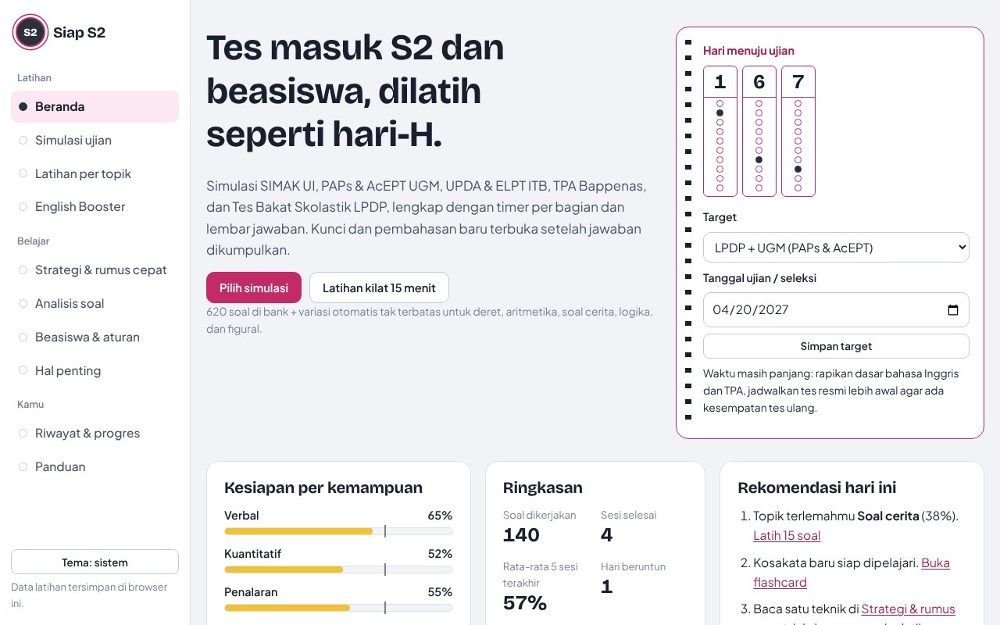
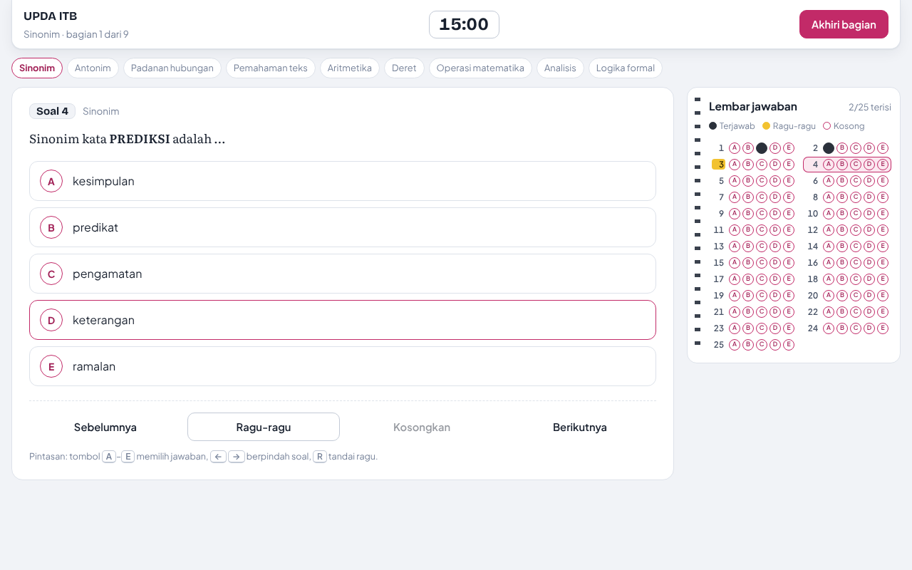
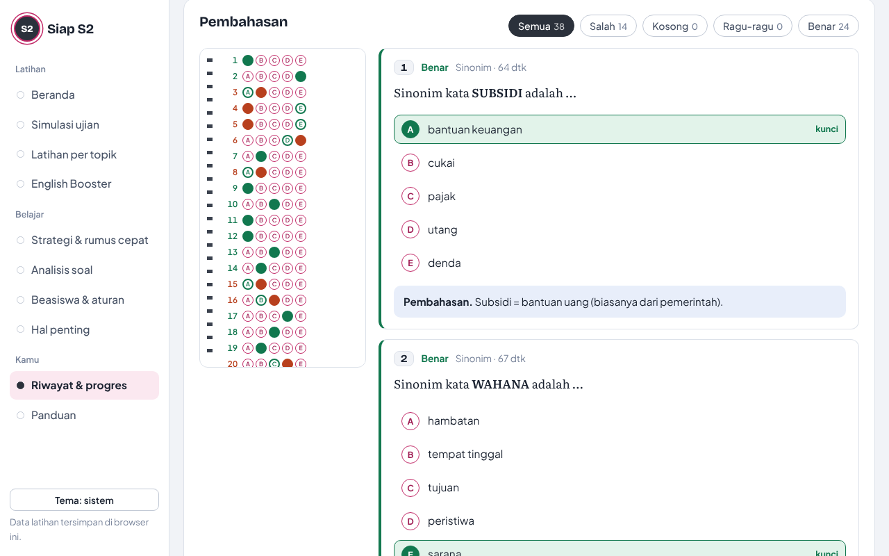

# Siap S2

Aplikasi latihan tes masuk S2 **UI, UGM, ITB** dan **beasiswa LPDP** dengan pengalaman seperti ujian sungguhan: timer per bagian, lembar jawaban ala LJK, nilai minus SIMAK, dan kunci jawaban yang **baru terbuka setelah jawaban dikumpulkan**.

Dibuat untuk belajar mandiri dan bersama teman. Gratis, tanpa akun, tanpa server, dan bisa dipakai offline.



## Isi aplikasi

| Fitur | Keterangan |
|---|---|
| **7 simulasi ujian** | SIMAK UI Magister, PAPs UGM, AcEPT UGM, UPDA ITB, TPA Bappenas, Tes Bakat Skolastik LPDP, ELPT ITB / TOEFL ITP. Versi penuh dan mini (±⅓ durasi). |
| **Bank soal** | 620 soal tertulis + 277 kosakata, semuanya dengan pembahasan. |
| **Variasi otomatis** | Generator untuk deret angka/huruf, aritmetika, operasi, aljabar, soal cerita, geometri, statistika, peluang, perbandingan kuantitatif, silogisme, ingkaran, urutan, figural, dan vocabulary. Kunci dihitung program, jadi soal tidak pernah habis. |
| **Kunci terkunci** | Kunci jawaban dan pembahasan disimpan terenkode dan baru didekode setelah sesi selesai. |
| **Rasa ujian asli** | Timer tidak bisa dijeda, bagian terkunci setelah diakhiri, audio listening hanya sekali putar, dan pencatatan "keluar halaman" seperti ujian daring berpengawas. |
| **Hasil & pembahasan** | Estimasi skor (skala 200–800, AcEPT, TOEFL), analisis per bagian dan per topik, catatan strategi otomatis, LJK berwarna, filter salah/kosong/ragu. |
| **Latihan per topik** | Pilih topik, jumlah soal, dan batas waktu. Latihan kilat siap pakai. |
| **Strategi & rumus cepat** | Teknik verbal, 8 pola deret, rumus soal cerita, tabel logika, strategi menebak +4/−1. |
| **English Booster** | Rencana 8 minggu, flashcard dengan pengulangan berjarak (Leitner), 25 aturan grammar, listening dengan suara browser, catatan soal salah. |
| **Beasiswa & aturan** | Syarat UI/UGM/ITB, aturan LPDP, kerangka esai, latihan wawancara bertimer (28 pertanyaan), LGD, esai on the spot, checklist dokumen. |
| **Jalur MBA & Teknik** | Syarat MM FEB UI, MBA/IMBA FEB UGM, MBA/MSM SBM ITB, MTMI ITB, Magister Teknik Industri UI, MeTSi UGM; aturan kelas reguler LPDP; kalkulator selisih skor bahasa Inggris; rencana 12 minggu; soal kuantitatif bisnis & data (BEP, markup vs margin, pertumbuhan, tabel). |
| **Analisis soal** | Format tiap tes dan perubahannya dari tahun ke tahun, peta topik, jatah waktu per soal, beserta sumbernya. |
| **Siap untuk Android** | Bisa dipasang ke layar utama (PWA), bisa dibuka tanpa internet (service worker), layar tetap menyala saat ujian, konfirmasi tombol Back, navigasi bawah, tombol besar untuk jari. |
| **Riwayat & progres** | Grafik skor, akurasi per topik, cadangan data untuk pindah perangkat. |

| Layar ujian | Pembahasan |
|---|---|
|  |  |

## Cara memakai

### Online (paling mudah untuk teman-teman)
Buka https://dhickywahyu.github.io/siap-s2/ (setelah GitHub Pages aktif). Progres tiap orang tersimpan di browser masing-masing.

### Di HP Android (seperti aplikasi)
1. Buka https://dhickywahyu.github.io/siap-s2/ di **Google Chrome**.
2. Ketuk **Pasang di HP** di Beranda, atau menu **⋮ → Instal aplikasi / Tambahkan ke layar utama**.
3. Buka dari ikon di layar utama. Setelah dibuka sekali saat online, aplikasi tetap jalan **tanpa internet**.

Selama ujian layar tetap menyala, tombol Back meminta konfirmasi, dan lembar jawaban dibuka dari tombol "Lembar jawaban".

### Offline di laptop
1. Klik **Code → Download ZIP**, lalu ekstrak.
2. Buka `index.html` dengan Chrome, Edge, atau Firefox.

Tidak perlu instalasi. Tanpa internet, huruf memakai font cadangan sistem.

### Alur belajar yang disarankan
1. Kerjakan **simulasi mini** tes target untuk diagnosis.
2. Lihat **topik terlemah** di halaman hasil.
3. Pelajari tekniknya di **Strategi & rumus cepat**.
4. Latih dengan **Latihan per topik** bertimer.
5. **Ulangi soal salah**, lalu simulasi penuh tiap 1–2 minggu.
6. **English Booster** setiap hari, minimal 10 menit flashcard.

## Menerbitkan di GitHub Pages

1. Buka **Settings → Pages** di repositori ini.
2. Pada **Build and deployment → Source**, pilih **Deploy from a branch**.
3. Pilih branch **main** dan folder **/ (root)**, lalu **Save**.
4. Tunggu 1–2 menit. Situs tersedia di https://dhickywahyu.github.io/siap-s2/

Setiap push ke `main` otomatis memperbarui situs. Workflow `.github/workflows/test.yml` menjalankan validasi bank soal dan uji otomatis pada setiap push dan pull request.

## Struktur folder

```
siap-s2/
├── index.html              # aplikasi (satu halaman, tanpa build untuk dipakai)
├── manifest.webmanifest    # identitas aplikasi untuk dipasang di HP
├── sw.js                   # service worker: mode offline
├── assets/
│   ├── css/app.css         # tampilan (token warna terang/gelap)
│   └── js/
│       ├── util.js         # RNG, enkode kunci, penyimpanan, renderer Markdown
│       ├── exams.js        # konfigurasi 7 simulasi + daftar subtopik
│       ├── generators.js   # generator soal otomatis
│       ├── engine.js       # mesin ujian, timer, LJK, penilaian, pembahasan
│       ├── content-data.js # pertanyaan wawancara, checklist, linimasa
│       └── app.js          # router, halaman, widget
├── bank/                   # SUMBER soal (mudah diedit)
├── content/                # SUMBER halaman belajar (Markdown, juga terbaca di GitHub)
├── data/                   # hasil build: bank.js, vocab.js, content.js
├── tools/
│   ├── build.js            # validasi + enkode kunci + gabung konten
│   ├── test.js             # uji otomatis
│   └── verify-puzzles.py   # verifikasi teka-teki penalaran analitis
└── docs/img/               # tangkapan layar
```

## Halaman belajar (bisa dibaca langsung di GitHub)

- [Analisis soal tes masuk S2 dan beasiswa](content/analisis-ujian.md)
- [Strategi & rumus cepat](content/strategi-rumus.md)
- [Beasiswa & aturan masuk S2](content/tips-beasiswa.md)
- [Hal penting yang sering terlewat](content/hal-penting.md)
- [Jalur MBA, Magister Manajemen & Magister Teknik](content/jalur-mba-teknik.md)
- [English Booster](content/english-booster.md) dan [25 aturan grammar](content/english-grammar.md)
- [Panduan memakai aplikasi](content/panduan.md)

## Menambah atau memperbaiki soal

```bash
node tools/build.js
```

```bash
node tools/test.js
```

Edit file di `bank/` atau `content/`, lalu jalankan dua perintah di atas (butuh Node.js 18+, tanpa dependensi). Detail format ada di [CONTRIBUTING.md](CONTRIBUTING.md).

> Catatan kejujuran: kunci jawaban di `data/bank.js` terenkode agar tidak terlihat sekilas, tetapi sumber soal di folder `bank/` berupa teks biasa untuk kemudahan kontribusi. Kalau ingin latihan jujur, jangan membuka folder `bank/` sebelum mengerjakan.

## Akurasi informasi

Format tes dan aturan beasiswa dirangkum dari sumber publik per **November 2026** (tautan sumber ada di setiap halaman). Penyelenggara tidak selalu memublikasikan detail resmi dan aturan dapat berubah setiap gelombang. Selalu cek laman resmi kampus, prodi, Bappenas, dan LPDP sebelum mendaftar. Skor di aplikasi adalah estimasi untuk melihat tren.

Soal disusun orisinal mengikuti gaya dan kisi-kisi tes, bukan salinan soal resmi. Aplikasi ini tidak berafiliasi dengan UI, UGM, ITB, Bappenas, maupun LPDP.

## Lisensi

[MIT](LICENSE). Silakan dipakai, dibagikan, dan dikembangkan.
